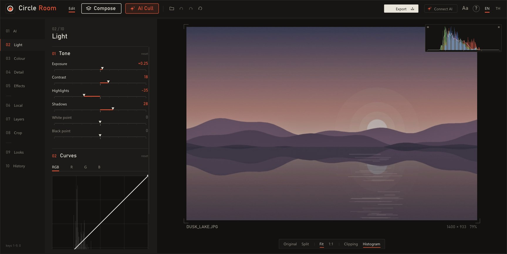

# Circle Room

**English** · [ภาษาไทย](README.th.md)

**A free, lightweight photo editor for Windows with on-device AI.** Edit with GPU-fast sliders, let AI pick your best shots, remove objects, cut out people, rebuild blown-out skies, and even let AI agents like Claude Code or Codex edit photos for you. Your photos never leave your computer.



> **Download:** https://godpoom.github.io/circle-room/ (or the [Releases](../../releases) page). Get `CircleRoom_Portable.zip` (with AI) or `CircleRoom_Lite.zip` (1.7 MB, no AI), unzip, and run `CircleRoom.exe`. Windows 10/11, 64-bit. No installer, no account.
>
> **Safety check:** VirusTotal scanned `CircleRoom.exe` 1.3.0: **0/71** ([report](https://www.virustotal.com/gui/file/84533589153d3ba2085ca5720e5839ba84dd409efc9fd8e0d117f08a937b7942))
> SHA-256 of `CircleRoom.exe`: `84533589153d3ba2085ca5720e5839ba84dd409efc9fd8e0d117f08a937b7942`. Check yours with `Get-FileHash .\CircleRoom.exe`, and feel free to scan your download yourself.

## Highlights
- **Light on your PC:** a 3 MB exe that uses about 12–20 MB of RAM with a 24 MP photo open, and 0% CPU when idle. Every slider renders on the GPU.
- **AI that runs on your computer:** no cloud, no sign-up, nothing uploaded. Models load only while they work, then free their memory.
- **AI Cull:** scores a whole folder (sharpness, closed eyes, exposure, composition, duplicates) and picks the best shots, about 30 photos per second.
- **Auto edit:** recognises the scene (portrait, sunset, food, night...) and edits to match, for one photo or a whole folder at once.
- **Magic eraser:** paint over people, wires or litter and AI fills in the background.
- **Compose:** stack up to 4 photos as layers, with AI background removal, blend modes and colour matching.
- **Local adjustments by AI:** brighten just the faces, deepen just the sky, without masking by hand.
- **Rebuild blown highlights:** AI recreates detail in pure-white areas that sliders alone cannot bring back.
- **Search photos by text:** "dog on the beach", "person with glasses" (English or Thai).
- **Works with AI agents (MCP):** Claude Code, Codex, Cursor, Gemini CLI, VS Code and more can use every tool and see each result.
- **Non-destructive:** originals are never changed; edits are saved next to each photo as a small `.pedit` file.
- **English and Thai interface**, a built-in tutorial (F1), and in-app updates.

## Who made it
Made by **IAMPOOM**, who also built **Circle Zone**, a small Thai/English language model designed and trained from scratch.
- [CircleZone 2.0 (70M)](https://huggingface.co/IAMPOOM/CircleZone-2.0-70M)
- [CircleZone 1.0 (33M)](https://huggingface.co/IAMPOOM/CircleZone-1.0-33M)
- [All work on Hugging Face](https://huggingface.co/IAMPOOM)

## Getting started
- Run `CircleRoom.exe`, then click the frame in the middle (or the folder button at the top), or drag a photo into the window. Supports JPEG, PNG (including 16-bit), BMP, TGA, PSD and GIF.
- The first launch starts a 12-step tour that highlights each part of the screen. Replay it any time with the **?** button or F1.
- **EN / TH** at the top right switches the language. **Aa** changes the text size (85–150%).
- Edits never touch the original. They are saved as `photo.jpg.pedit` next to the photo and come back when you reopen it.

### The editor
The look is a darkroom and camera body: warm graphite, paper-coloured text, and a red safelight accent used only for state. Numbers use Bahnschrift, the DIN font that ships with Windows, like the markings on a lens.

| Page | What you can adjust |
|---|---|
| 1 AI | Auto edit, rebuild blown highlights, edit like reference photos, auto edit many photos |
| 2 Light | Exposure, contrast, highlights/shadows (local), white/black point, RGB and per-channel curves over the histogram |
| 3 Colour | White balance (Bradford), vibrance (protects skin), saturation, 8-band hue/saturation/luminance, colour grading wheels for shadows/midtones/highlights/global |
| 4 Detail | Fine detail, local contrast, haze removal, sharpening (amount/radius/edges only), luminance and colour noise reduction |
| 5 Effects | Vignette, film grain |
| 6 Local | Adjust only faces, people, sky, road and other areas the AI finds |
| 7 Layers | Photo layers, AI cut-outs, magic eraser, eraser, blend modes (also the **Compose** button at the top) |
| 8 Crop | Free or fixed-ratio crop, straighten ±45° (the crop fits itself), rotate 90°, flip |
| 9 Looks | 6 built-in looks (hover to preview on the photo) and your own saved looks (`presets\*.plook`) |
| 10 History | Every step; click one to go back to it |

Export to JPEG or PNG, optionally resized.

- **Sliders** look like the scale on a lens ring: ticks every 10%, a long tick at the default, a wedge at the current value. Changed values turn red. Double-click to reset, Ctrl+click to type a number.
- **Under the photo:** Before · Split | Fit · 1:1 | Clipping warning · Histogram.

### Shortcuts
| Key | Action |
|---|---|
| Ctrl+O / Ctrl+E | Open / Export |
| Ctrl+Z / Ctrl+Y | Undo / Redo |
| 1 – 9, 0 | Switch tool page (0 = page 10) |
| [ / ] | Smaller / bigger brush (layer eraser) |
| Ctrl + / Ctrl − / Ctrl 0 | Bigger / smaller / 100% text |
| `\` | Show the original |
| Z or double-click the photo | Fit / 100% |
| Mouse wheel / drag | Zoom / pan |
| R / Esc | Enter / leave crop mode |

## AI Cull (the "AI Cull" tab)
1. Choose a folder (or drop one on the window). Every photo is analysed in the background.
2. Choose how many to show: 10 / 50 / 100 / a number you type / all.
3. Each photo gets a 0–100 score with reasons such as blurry, eyes closed, overexposed, tilted, subject cut by the edge, good composition.
   - The score has three parts you can weight: technical (sharpness, light, noise), aesthetics, and composition.
   - Bursts of similar shots are grouped and only the best of each group is picked (an `x4` badge means 4 similar photos).
4. Double-click a photo or press Enter to edit it.
5. **Keep only the good ones:** right-click photos you don't want to leave them out, then click **Save the picks (N)** and choose a folder.
   - **As JPEG with your edits:** edited photos are exported at full size; unedited ones are copied as they are.
   - **Copy the original files:** exact copies; any edits go along as `.pedit` files.
   - Nothing is deleted, moved or overwritten. Name clashes become `name (2).jpg`.
6. **Clear AI cache** deletes only that folder's analysis, thumbnails and AI fills (never photos or `.pedit` files) and analyses again.

**"Like references" mode:** add at least 5 example photos and the ranking favours photos that are both good and similar to them, in scene and in colour. A Quality / Similarity slider sets the balance, and **Save as style...** keeps the set for later.

**Search by text (English or Thai):** type in the search box above the grid, e.g. "dog", "person with glasses", "kite on the beach", and press Enter.
- Thai is translated to English on your computer first (opus-mt-th-en), then matched against the photos with CLIP using the existing analysis, so nothing is re-analysed.
- **Strictness** hides weak matches, and **Find similar photos** in the right panel searches by a photo instead of words.
- The text models (~170 MB) leave memory after 60 seconds without a search.

## Auto edit (no references needed)
- **In the editor:** open page **01 AI** and click **Auto edit**.
  - The AI recognises the scene (portrait, group, landscape, sunset, night, food, beach, snow...) and aims for a look that suits it.
  - It sets light, white balance, vibrance and curves, and adds local adjustments when it finds sky or people (recovering a bright sky, lifting dark faces).
  - It renders 9 candidates and keeps the one CLIP's aesthetic score likes best.
  - The result is ordinary slider values you can keep editing, plus a strength slider.
- **Many photos at once:**
  - Start from the **Auto edit many photos** card on page 01 AI (**Choose photos...**, **Whole folder...** or **All photos in this photo's folder**), or from **Auto edit (N)** in AI Cull, which edits your picks.
  - Each photo gets its own edit for its scene, including local adjustments and highlight rebuilding, at 0–150% strength.
  - **Skip photos I already edited** (on by default) keeps your own work. Turn it off to replace the edit; crop, layers and magic-eraser work stay.
  - **Also save as JPEG** exports full-size files to a folder you choose, never overwriting originals.
  - The AI runs in the background, so you can keep working; the progress card at the bottom right can cancel. If the open photo is edited, you see it at once and can undo it.

## Let AI agents edit with Circle Room (MCP)
Circle Room is also an **MCP server**. AI agents that speak MCP, such as Claude Code, Codex, OpenCode, MiMo Code, Kimi Code, Qwen Code, DeepSeek TUI, Z Code, Antigravity, Cursor, Claude Desktop, Gemini CLI, Windsurf and VS Code (Copilot), can use every tool in the app and **see the result after each step**.

**Setup:** click **Connect AI** at the top right of the app, pick the tab for your AI app, and click **Copy** (the program path is already filled in). You only do this once.

| AI app | Where it goes |
|---|---|
| Claude Code | Run `claude mcp add --scope user circle-room -- "<path>\CircleRoom.exe" --mcp` |
| Codex (OpenAI) | `[mcp_servers.circle-room]` in `%USERPROFILE%\.codex\config.toml` |
| OpenCode | `"mcp"` in `%USERPROFILE%\.config\opencode\opencode.json` (snippets for 1.x and 2.x) |
| MiMo Code (Xiaomi) | `"mcp"` in `%USERPROFILE%\.config\mimocode\mimocode.jsonc` |
| Kimi Code | `kimi mcp add --transport stdio circle-room -- ...` or `%USERPROFILE%\.kimi-code\mcp.json` |
| Qwen Code | `mcpServers` in `%USERPROFILE%\.qwen\settings.json` |
| DeepSeek TUI (CodeWhale) | `%USERPROFILE%\.deepseek\mcp.json` (newer: `%USERPROFILE%\.codewhale\mcp.json`) |
| Z Code (Zhipu) | The app's MCP settings: command `CircleRoom.exe`, argument `--mcp` |
| Antigravity | Agent panel > ... > MCP Servers > Manage > View raw config (`mcp_config.json`) |
| Cursor, Claude Desktop, Gemini CLI, Windsurf | `mcpServers` in each app's MCP settings file |
| VS Code (Copilot) | `.vscode/mcp.json` |

For plain-text setup snippets (for scripts), run `CircleRoom.exe --mcp-config`.

**Then just ask in plain language**, for example:
- "Edit D:\Trip\IMG_0012.jpg: bluer sky, slightly brighter faces, crop to 4:5"
- "Remove the person walking past on the left"
- "Pick the 10 best photos in D:\Trip, auto edit them all and export JPEGs to D:\Trip\best"
- "Find the photos with someone wearing glasses in this folder"

**Tools the agent gets (20):**
| Group | Tools |
|---|---|
| Look | `open_photo`, `view` (before/after side by side), `get_info`, `list_adjustments` |
| Edit | `set_adjustments` (every slider and curve), `auto_edit`, `apply_look`, `crop_rotate`, `undo` |
| Local AI | `find_regions`, `adjust_region` (faces, people, sky, water...), `recover_highlights`, `magic_erase` |
| Compose | `layer_add` (AI cut-out, colour matching), `layer_update`, `layer_remove` |
| Folders | `cull_folder` (best shots + contact sheet), `search_photos` (English or Thai), `batch_auto_edit` |
| Save | `export` (full-size JPEG/PNG, never overwrites) |

**Watch what the AI is doing:** keep Circle Room open while the agent works.
- The **Connect AI** button turns into the connected app's name (e.g. "Claude Code"): a green dot when it is waiting, a pulsing orange dot when it is working. Click to show or hide the activity card; right-click for the setup dialog.
- A card at the bottom right shows the tool in use (e.g. "Now: Adjust light & colour") and recent steps with what changed (e.g. "Exposure 0 → 0.35", "Local adjustment: Faces").
- The open photo updates as the AI edits it, with an outline and an "Edited by Claude Code" label. Each step is one undoable entry in History.
- With **Open the photo the AI is editing** on (the default), the app follows the agent to the photo it works on.
- Several agents can be connected at once; each gets its own section on the card.

More details:
- Every editing tool returns a **preview image** plus numbers (brightness, % clipped highlights/shadows, colour balance), so the agent decides its next step from the actual photo.
- Coordinates (spots to erase, layer positions) are 0–1 of the image the agent sees.
- Nothing overwrites originals: edits go to `.pedit` files you can open and continue in Circle Room.
- Everything runs locally. The only thing that leaves is the preview images sent to the AI app you use (which may pass them to its provider, as it normally does).
- Use the Portable build to get all AI tools. If you move the program folder, copy the setup again.
- Under the hood: `CircleRoom.exe --mcp` speaks JSON-RPC over stdin/stdout as the MCP standard defines.

## Local adjustments by AI (page "Local")
- Opening the page lets the AI find the parts of the photo (UperNet-ConvNeXt-T, about 2 seconds the first time, in the background).
- Buttons appear for what it found, e.g. `Faces 2`, `People 12%`, `Sky 46%`, `Road & paths 31%`, Buildings, Trees & plants, Water, Vehicles, Animals, and "Background (not people)".
- **Faces:** YuNet finds each face and the area is trimmed to the person, so you can brighten a face or reduce redness without touching clothes or background. **Invert** adjusts everything except the faces.
- Click an area to add an adjustment layer (up to 4). Each has exposure, contrast, highlights, shadows, temperature, tint, saturation, local contrast and feather, plus **Invert** and **Remove**.
- Hover a layer to see its area in red. Edges follow the real edges in the photo (guided filter).
- Everything is stored in `.pedit`, so it undoes and exports normally.

## Compose (the "Compose" button at the top)
The third main mode next to **Edit** and **AI Cull**, with a vertical toolbox on the left edge of the photo, like a typical image editor:

| Tool | Key | What it does |
|---|---|---|
| Move | V | Select, move, resize and rotate layers |
| Magic eraser (AI) | J | Paint over something on the main photo and AI fills the background |
| Eraser | E | Erase part of the selected layer |
| Restore | B | Paint parts of the layer back |
| + | | Add a photo on top |

### Magic eraser (AI)
- Paint over what you don't want, such as passers-by, wires, litter or marks on a wall, and let go. The AI fills in a background that blends with its surroundings (about 1–3 seconds).
- Uses LaMa (Apache-2.0, fine for commercial use), included in the app.
- Small objects are filled at full resolution; for large ones the AI looks at a wider area, so detail is softer.
- After the fill, three clean-up passes: tone matched to the surrounding edge, grain matched to the photo, and the whole painted area replaced so no faint ghost of the object remains.
- Erase as many times as you like; each pass sees the previous ones. Every pass can be undone, and **Clear all** removes them.
- Originals stay untouched: strokes live in `.pedit`, AI fills in `.photoeditor_cache`, so reopening needs no re-run.

### Layers
Stack up to 4 photos on top of the main one, e.g. move a person from one photo into another scene.
- **Add:** click **+ Add a photo on top**, or drop an image file on the photo while on this page.
- **Move / resize / rotate:** drag the layer; drag a corner to resize; drag the round handle to rotate (hold Shift for 15° steps). Click the photo to select the layer under the mouse.
- **Remove the background (AI):** keep only the main subject automatically, or choose which parts to keep (people, animals, vehicles...). Adjust **Edge softness**.
- **Eraser / Restore:** paint away what the AI kept by mistake, or paint it back. `[` and `]` change the brush size.
- **Blending:** opacity and 7 blend modes (normal, multiply, screen, overlay, soft light, darken, lighten).
- **Match to the photo:** automatic, or set the layer's exposure, temperature and saturation yourself.
- Reorder, hide, invert or remove layers; every step can be undone.
- Edits on the other pages (light, colour, crop, looks) apply to the whole composite, so layers blend into the main photo.
- Originals are not modified. Layer positions and strokes are stored in `.pedit` as paths to the layer images; if you move or delete a layer's image, that layer can no longer be opened.

## Rebuild blown highlights (page "AI")
Pure white (255) has no data left; lowering highlights or exposure only turns it grey. This card rebuilds those areas:
- The card shows how much of the photo is blown out. Click **Recover with AI** (runs in the background, about 3–7 seconds).
- **Colour** comes from the unclipped edge of each area, per region the AI found (faces get skin tones, skies get blue).
- **Brightness** falls off naturally from the edge inward; areas clipped in only one or two channels keep their own detail.
- **Detail** comes from LaMa inpainting (its brightness only, not its colour), for up to 2 large areas per photo.
- The **Strength** slider applies instantly. Hover the card to see the rebuilt areas in red.
- The result is an overlay blended before every other step, so all sliders still work on it. It is cached in `.photoeditor_cache\` next to the photo.
- Auto edit calls it automatically when more than 0.5% of the photo is blown out.

## Edit like reference photos
- **In the editor:** page **AI** → the reference card → pick a style (or **New style from photos...**, choosing at least 5) → **Apply**.
  - The AI moves the sliders for you (light, colour, HSL, grading, curves), so you can keep editing and undo.
  - **Strength** changes the result instantly without recomputing.
- **Many photos:** in AI Cull, pick a style and click **Edit shown photos like references**. Each photo is solved on its own (a darker photo gets more exposure), and saved as `.pedit` next to it.

### How the AI works, and why it is light
- **One main model:** CLIP ViT-B/32 int8 (85 MB) runs once per photo and its result is reused for aesthetics (LAION aesthetic head), composition (pre-computed prompts), duplicates and reference similarity.
- **Faces:** YuNet (0.2 MB) finds faces to measure face sharpness and detect closed eyes.
- **No model needed for:** sharpness, exposure, noise, saliency (rule of thirds / subject at the edge) and tilt.
- **Reference editing** is not AI image generation: it optimises the slider values on the same GPU pipeline (about 300–500 iterations in 0.4–0.7 s per photo).
- **Memory:**
  - ONNX Runtime loads only during analysis and is released right after.
  - JPEGs are decoded at 1/8 scale while reading (Windows WIC).
  - Results are cached in hidden `.photoeditor_ai` and `.photoeditor_thumbs` files in the photo folder; reopening takes under 0.1 s.
- **Measured (CPU, RTX 4060 Laptop):** 207 photos in 6.9 s (about 30 per second); peak RAM 290 MB during analysis, back to 2 MB afterwards. DirectML (GPU) is slower with this int8 model, so CPU is the default (`--gpu` to try it).

## In-app updates
- When it starts, Circle Room asks GitHub whether there is a newer version (at most once a day; a plain request with nothing about you or your photos). If there is, you get a message and an orange **Update x.y.z** button at the top right.
- Click it to see what's new, then **Update now**. It downloads the zip that matches your build (Portable or Lite) with a progress bar; then click **Restart now** (or later: the next start uses the new version).
- Safety:
  - Downloads only over HTTPS from this project's GitHub releases.
  - The zip must match the SHA-256 in the release's `SHA256SUMS.txt`, or nothing is installed.
  - Every file in the zip is CRC-checked, and names that try to escape the program folder are refused.
- Only changed files are replaced. New files are fully unpacked to a staging folder first, then swapped in at once; if any step fails, everything rolls back to the current version. Replaced files are removed on the next start.
- Photos, `.pedit` files, presets and `settings.ini` are never touched.
- If the program folder is not writable (e.g. under Program Files), you get a button to the download page instead.
- Click the version number at the bottom right (e.g. `v1.2.1`) to check any time, turn automatic checks off, or skip a version.
- Works from the first version that includes it; older versions need one manual download.

## Why it is light
- Images are decoded and uploaded to the GPU right away, then the CPU copy is freed (pixels don't sit in RAM).
- The preview renders only the pixels on screen, and only when something changes. Idle means 0% CPU.
- Undo stores parameters (about 1 KB per step), never images.
- Export renders in 1024² tiles on the GPU.

Measured on an RTX 4060 Laptop with a 24 MP (6000×4000) photo:
- RAM shown in Task Manager (private working set): about 12–20 MB with the photo open
- 1600×1000 preview with every tool on: 1.1 ms per frame
- Full-resolution export: 53 ms of rendering (the rest is JPEG/PNG encoding)

## Build
Needs MinGW-w64 (g++), CMake and Ninja. Then run:
```
powershell -ExecutionPolicy Bypass -File build.ps1
```
The script builds through a junction in `%TEMP%`, because Ninja can't handle folders with Thai names.

Output: `bin\CircleRoom.exe` (about 3 MB, nothing else to install). The AI features use the files in `bin\ai\` (about 466 MB more); without that folder the editor still works.

This repo holds the source only. The AI model files (~490 MB) are in the release zip: to build with AI, copy the `ai\` folder from the zip into the project's `ai\`. Licences for libraries and models are in [THIRD_PARTY_NOTICES.md](THIRD_PARTY_NOTICES.md), with full texts in [LICENSES](LICENSES).

Command-line tools (no window):
```
CircleRoom.exe --export in.jpg settings.pedit out.jpg [--long 2048] [--quality 92]
CircleRoom.exe --bench in.jpg
CircleRoom.exe --ai-rank <folder> [--top N] [--refs <reference folder>] [--all] [--gpu]
CircleRoom.exe --ai-style <reference folder> in.jpg out.jpg [--strength 0-100]
CircleRoom.exe --make-style <name> <photo folder>
CircleRoom.exe --ai-search <folder> "<text>" [--top N]
CircleRoom.exe --ai-auto in.jpg out.jpg [--no-layers]
CircleRoom.exe --ai-recover in.jpg out.jpg [--strength 0-100] [--no-regions]
CircleRoom.exe --ai-mask in.jpg <region 0=people 1=sky 2=road ...> mask.png [--invert] [--feather F]
CircleRoom.exe --ai-tokcheck <test file>   (checks the tokenizers against Python)
CircleRoom.exe --selftest                  (safety and regression checks)
```
`tools/export_tokenizers.py` builds `mt_vocab.bin` and `clip_bpe.bin`; `tools/make_prompts.py` builds the scene prompts in `prompts.bin`.

### Models (in `ai/`, run on the CPU and loaded only when used)
| File | Size | Used for |
|---|---|---|
| clip_b32_vision_int8 | 85 MB | Photo analysis, scores, scene detection |
| clip_b32_text_int8 + clip_bpe.bin | 63 MB | English search text to embeddings |
| mt_th_en_encoder/decoder_int8 + mt_vocab.bin | 106 MB | Thai→English translation for search |
| upernet_convnext_t_ade_fp16 | 115 MB | 150-class segmentation, grouped into 13 regions (MIT; built with `tools/export_upernet.py` + `tools/fp16_onnx.py`) |
| lama_inpaint | 89 MB | Magic eraser and highlight detail (LaMa from OpenCV Zoo via `tools/prepare_lama.py`) |
| yunet | 0.2 MB | Face detection |
| onnxruntime.dll (+ DirectML.dll) | 32 MB | Model runtime |

The AI files live in `ai/` and are copied to `bin\ai\` by the build. `tools/convert_head.py` and `tools/make_prompts.py` rebuild `aesthetic_b32.bin` and `prompts.bin` (needs Python, onnxruntime and tokenizers).

## Project layout
- `src/shaders.h`: the whole colour pipeline (GLSL): Pass A (tone/colour) and Pass B (sharpening/noise/vignette/grain)
- `src/renderer.*`: textures, FBOs, geometry (crop/rotate/EXIF) and tiled export
- `src/ui_panels.*`, `src/ui_icons.*`, `src/main.cpp`: UI (theme, sections, scale sliders, line icons drawn in code with no image or icon fonts)
- `src/mcp_server.*`, `src/mcp_json.h`: the MCP server (`--mcp`) that gives AI agents every tool
- `src/agent_log.*`, `src/ui_agent.*`: the agents' activity log (`%LOCALAPPDATA%\CircleRoom\agents`) and the in-app card showing which AI is connected and what it is doing
- `src/updater.*`, `src/ui_update.*`: checking and installing updates from GitHub releases (WinHTTP, SHA-256 via BCrypt, own zip reader)
- `src/version.h`: the single version number (the exe, the updater and MCP read it; `tools/package_release.py` refuses to package a different one)
- `src/ui_batch.*`: auto edit many photos (background thread + progress card)
- `src/heal.*`: magic eraser (strokes, background LaMa jobs, result cache); compositing on the GPU in `kPatchShader`
- `src/layers.*`: photo layers (loading, AI cut-outs, eraser strokes, colour matching); compositing on the GPU in `kComposeShader`
- `src/params.*`, `src/history.*`, `src/curves.*`, `src/i18n.*`: parameters, history, curves and translations
- `third_party/`: GLFW 3.4, Dear ImGui 1.91.8, stb_image

## Name and logo
**Circle Room**: the logo is "a circle in a room": a rounded graphite square (the room) with a paper-coloured ring (lens or window) and a low red safelight circle inside, like a sunset seen through a window. It is generated by `tools/make_logo.py` into `res/circleroom.ico`, embedded in the exe through `res/circleroom.rc`.

## Safety of the files you open
Photos, `.pedit` files, caches and thumbnails may come from someone else or be damaged, so they are always checked before use:
- **Caches / thumbnails:** entry counts, sizes and offsets are checked against the real file size before allocating memory; damaged ones are re-analysed.
- **Images:** files claiming more than 500 megapixels or a side over 131,072 px are refused before allocating memory.
- **`.pedit`:** NaN, infinite and out-of-range values are clamped; crops are kept inside the photo; strokes and points are capped; files over 32 MB are ignored.
- **Layers:** only local image files open. Network shares (`\\host\share`) are refused, because opening them sends your Windows credentials to that machine.
- **DLLs:** ONNX Runtime and its dependencies load only from `ai\` and System32, never from the current folder or PATH.
- **Writing files:** `.pedit` files and exports are written to a temporary file first and swapped in when complete, so a full disk or power cut never corrupts the old file.
- Check it yourself with `CircleRoom.exe --selftest`, which builds many damaged or tampered files and checks the program refuses them without crashing.

## Limitations
- RAW files (CR2/NEF/ARW/DNG) are not supported yet.
- ImGui has no Thai text shaping, so words with both an upper vowel and a tone mark may overlap slightly.
- Aesthetic scores are a statistical estimate (from LAION/AVA data), not your taste. For your taste, use reference mode.
- Tilt detection needs straight lines (horizon, buildings); it is weak on nature shots without them.
- Reference editing works best when the references are similar scenes. Very different scenes can make content colours (blue sky, teal water) partly read as style.
- **Segmentation:**
  - Works by category: all people in a photo form one area; you can't pick a single person yet.
  - Masks are built at 1536 px, so edges look slightly soft at 100% on large photos.
  - The first photo takes about 3 seconds, mostly loading the model.
- **Thai search** goes through translation first, so a poor translation can miss (e.g. "คนกำลังวิ่ง", "a person running", is not great yet). English goes straight to CLIP.
- **Auto edit** uses general rules per scene; strong colour casts are only partly corrected.
- **Rebuilding highlights:**
  - The AI *creates* plausible detail, not the real data (clouds or skin texture may differ from reality).
  - Very large areas (e.g. half the sky blown out) get soft gradients more than sharp detail.
  - Small specular highlights (catchlights, glints on water) are deliberately left white.
  - Colour comes from the area's edge, so a warm edge (an evening sky) gives a warm result.
  - It uses about 560 MB of RAM for a few seconds, then frees it all.
- **Bitdefender:** if the build fails with `Permission denied`, Bitdefender is scanning or blocking the overwrite of `CircleRoom.exe`. Add the project folder and `%TEMP%\circleroom_build` to its exclusions, or wait for the scan to finish.
- The Visual C++ Runtime (already on most Windows PCs) is needed for ONNX Runtime; without it, AI Cull falls back to the non-model scores.
